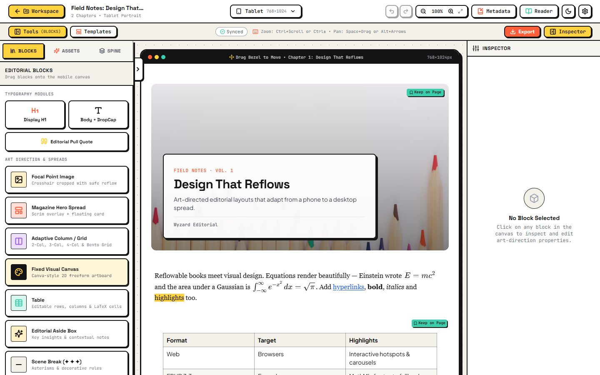
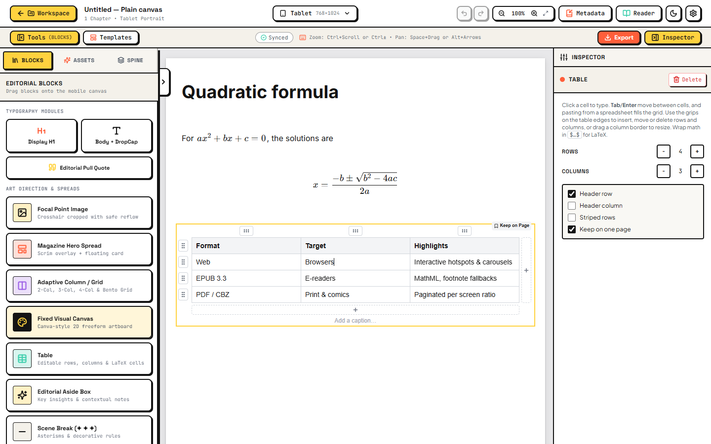
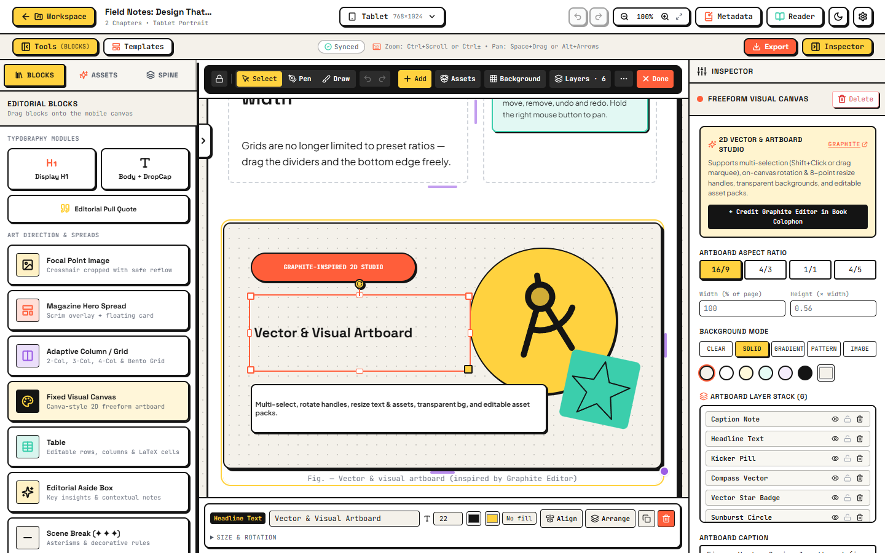
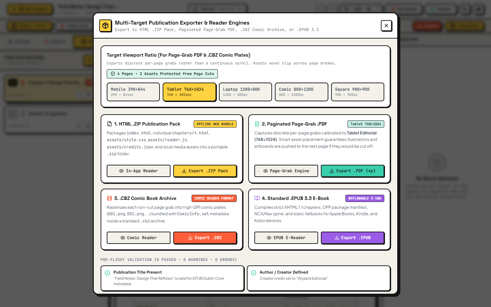
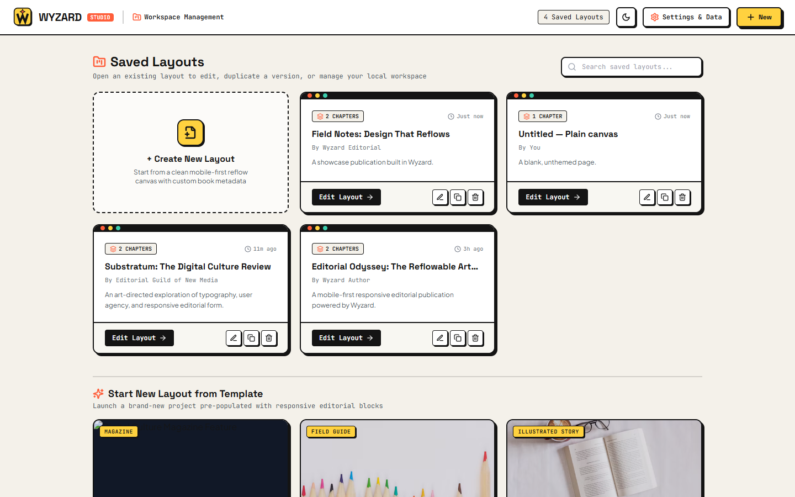
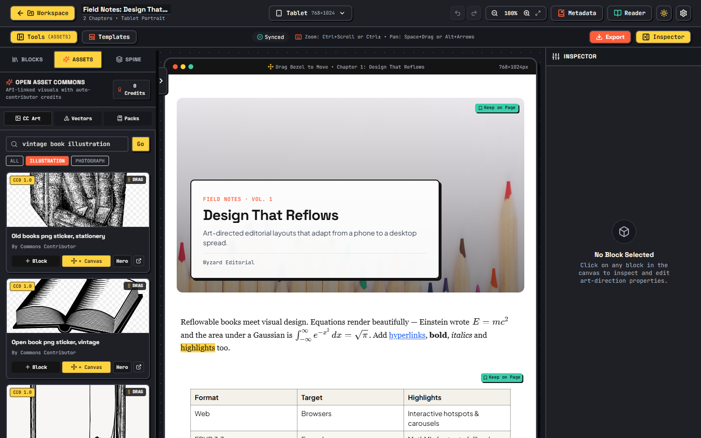
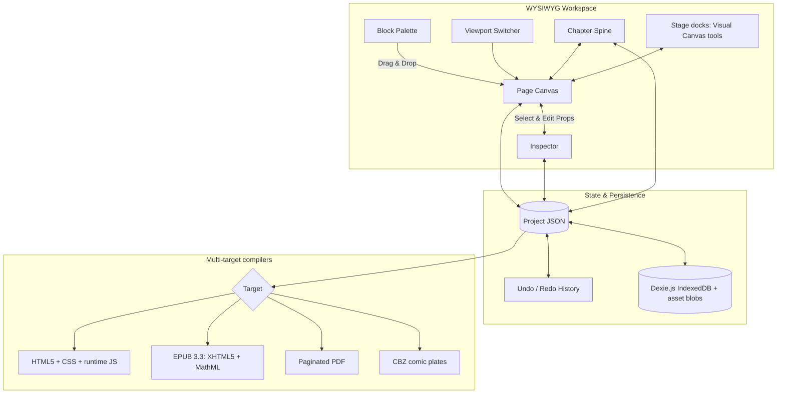
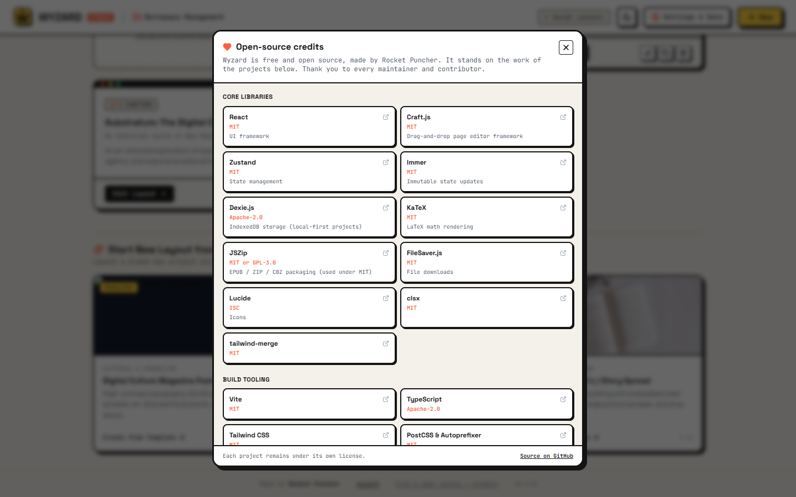

<p align="center">
  
</p>

<p align="center">
  <strong>A free, local-first visual studio for e-books, comics and editorial publications.</strong><br />
  Design on a blank canvas or a reflowable page, then export to Web, EPUB 3, PDF and CBZ.
</p>

<p align="center">
  <a href="https://github.com/cmosqueda/wyzard/releases/latest"></a>
  
  
</p>

<p align="center">
  
</p>

---

## What is Wyzard?

Digital publishing is stuck between two extremes: fixed-layout files force phone readers to pinch and zoom, and plain reflowable e-books throw away art direction. **Wyzard** gives you both. Start from a mobile-first reflowable page with magazine-grade blocks, or from a blank Canva-style canvas, and compile the same design into responsive web pages, valid EPUB 3.3 packages, paginated PDFs and comic archives.

Everything runs in your browser and is stored on your own device. There is no account and no server.

---

## ✨ Highlights

### Design system choice: Wyzard Editorial or a blank, unthemed canvas
New projects start on a **Plain canvas**: a white page with no styling, like Canva or Figma. Switch any project to the **Wyzard Editorial** look (neo-brutalist type, borders and accents) from **Metadata → Canvas Design System**. Web, EPUB, PDF and CBZ exports follow the choice.

<p align="center">
  
</p>

### Notion-style tables and LaTeX math
- **Table block:** click to type, `Tab` / `Enter` to move between cells, paste straight from a spreadsheet, drag column borders, insert / move / delete rows and columns, header row and column, striped rows and per-column alignment.
- **LaTeX** (KaTeX): the **Σ** button in the text toolbar, or just type `$x^2$` / `$$\int f$$`. Click an equation to edit it with a live preview. Math also works inside callouts, accordions and table cells, and exports as **MathML** in EPUB.

### Fixed Visual Canvas (Canva-style artboard)
A free-form 2D artboard for posters, infographics and comic plates: shapes, text, images, vector pen and brush, transparent or rich backgrounds, asset packs, layer manager, align / distribute, rotate and flip.
- Drag the **right edge, bottom edge or corner** for any width and height.
- The toolbars open in **docks outside the device preview**, so they stay readable even in Mobile view (`Done` or `Esc` to leave).
- One drag, resize or rotate is **one undo step**.

<p align="center">
  
</p>

### Typography that stays out of your way
Pick from **Google Fonts** (open-source families, plus any family name you type), set size, color, alignment and spacing, add **hyperlinks**, and toggle bold / italic / underline / highlight with visible active states. Advanced options (line height, tracking, drop caps) are collapsed until you need them.

### Adaptive grids you can size freely
Column and grid blocks collapse to one column on phones. On wider screens, **drag the column dividers and the bottom edge** to any size, or start from a preset ratio. Hotspot / pinboard **pins are draggable** right on the image.

### Export everywhere
One design, four targets: an offline **HTML .ZIP** pack, a paginated **PDF**, a **.CBZ** comic archive, and a standards-based **EPUB 3.3**, each with an in-app reader preview and pre-flight validation.

<p align="center">
  
</p>

### A workspace you can trust
Projects live in your browser's IndexedDB, are saved on every change, and **come back after an accidental refresh** (same project, chapter, viewport and zoom). Browse, duplicate and rename layouts in the workspace, or start from a template.

<p align="center">
  
</p>

### Light and dark studio
<p align="center">
  
</p>

---

## ⌨️ Shortcuts & mouse

| Action | Shortcut |
| --- | --- |
| Remove the selected block / layers | `Delete` or `Backspace` |
| Copy / paste blocks (also pastes text and images from your system clipboard) | `Ctrl + C` / `Ctrl + V` |
| Duplicate | `Ctrl + D` |
| Undo / redo | `Ctrl + Z` / `Ctrl + Shift + Z` (or `Ctrl + Y`) |
| Save now | `Ctrl + S` |
| Zoom | `Ctrl + Scroll`, `Ctrl + +` / `Ctrl + -`, `Ctrl + 0` to reset |
| Pan the canvas | **Right-mouse drag**, `Space + drag`, or `Alt + Arrows` |
| Context menu (duplicate, move, remove, undo / redo; layer order inside a Visual Canvas) | **Right-click** |

Dragging a block near the top or bottom of the stage auto-scrolls the page.

---

## 🧱 Block library

| Block | Notes |
| --- | --- |
| **Typography** | H1–H3, lead, body, pull quote, Google Fonts, links, LaTeX, drop caps |
| **Table** | Notion-style rows and columns, LaTeX in cells |
| **Image** | Focal-point crosshair, aspect ratios, full-bleed, local upload |
| **Magazine Hero Spread** | Scrim overlays and a floating title card |
| **Column / Grid** | 2–4 columns and bento, freely resizable |
| **Fixed Visual Canvas** | Free-form artboard with vector tools and asset packs |
| **Hotspot Pinboard** | Draggable numbered pins, footnote fallback in EPUB |
| **Visual Gallery** | Carousel on phones, grid on desktop |
| **Accordion · Callout · Audio · Scene break** | Interactive and editorial blocks, with a pagination guardrail |

### Starter templates
Digital Culture Magazine Feature, Interactive Educational Field Guide, and an Illustrated Children's Story Spread.

---

## 🚀 Quick start

```bash
npm install
npm run dev        # http://localhost:5173
npm run build      # type-check + production build into dist/
```

### Install as a browser extension (Chrome, Edge, Brave)
1. Download `wyzard-browser-extension-vX.Y.Z.zip` from the [latest release](https://github.com/cmosqueda/wyzard/releases/latest) and unzip it.
2. Open `chrome://extensions`, enable **Developer mode**, click **Load unpacked** and pick the folder.
3. Click the Wyzard icon to open the full-tab studio. Everything stays on your device.

---

## 🏗 Architecture



**Tech stack:** React 19 · TypeScript · Vite · Craft.js · Zustand + Immer · Dexie.js (IndexedDB) · Tailwind CSS · KaTeX · JSZip + FileSaver.js · Lucide icons.

---

## ❤️ Credits & open source

**Wyzard is free and open source**, made by **[Rocket Puncher](https://github.com/cmosqueda)**. It would not exist without the work of the projects below, each used under its own license. The same list is available inside the app from the footer of the workspace page.

<p align="center">
  
</p>

**Core libraries**

| Project | License | Used for |
| --- | --- | --- |
| [React](https://react.dev) | MIT | UI framework |
| [Craft.js](https://craft.js.org) | MIT | Drag-and-drop page editor framework |
| [Zustand](https://github.com/pmndrs/zustand) | MIT | State management |
| [Immer](https://immerjs.github.io/immer/) | MIT | Immutable state updates |
| [Dexie.js](https://dexie.org) | Apache-2.0 | IndexedDB storage |
| [KaTeX](https://katex.org) | MIT | LaTeX math rendering |
| [JSZip](https://stuk.github.io/jszip/) | MIT or GPL-3.0 (used under MIT) | EPUB / ZIP / CBZ packaging |
| [FileSaver.js](https://github.com/eligrey/FileSaver.js) | MIT | File downloads |
| [Lucide](https://lucide.dev) | ISC | Icons |
| [clsx](https://github.com/lukeed/clsx), [tailwind-merge](https://github.com/dcastil/tailwind-merge) | MIT | Class name utilities |

**Build tooling:** [Vite](https://vite.dev) (MIT) · [TypeScript](https://www.typescriptlang.org) (Apache-2.0) · [Tailwind CSS](https://tailwindcss.com) (MIT) · [PostCSS](https://postcss.org) and Autoprefixer (MIT)

**Fonts:** [Space Grotesk](https://fonts.google.com/specimen/Space+Grotesk), [Plus Jakarta Sans](https://fonts.google.com/specimen/Plus+Jakarta+Sans) and [JetBrains Mono](https://www.jetbrains.com/lp/mono/) (SIL OFL 1.1), plus the open-source families served by [Google Fonts](https://fonts.google.com) in the font picker (OFL / Apache-2.0 per family).

**Open content & services:** [Openverse](https://openverse.org) (openly licensed images, license per work) · [Iconify](https://iconify.design) (vector icon search, license per icon set) · [Adamsdesk](https://www.adamsdesk.com/posts/free-design-asset-resource/) (free design asset directory) · [Unsplash](https://unsplash.com) (sample photographs in the starter templates, Unsplash License) · [Graphite](https://graphite.rs) (Apache-2.0, design inspiration for the vector canvas).

Assets inserted from the asset library are logged automatically in **Metadata → Contributor Credits** and written into the exported colophon.
