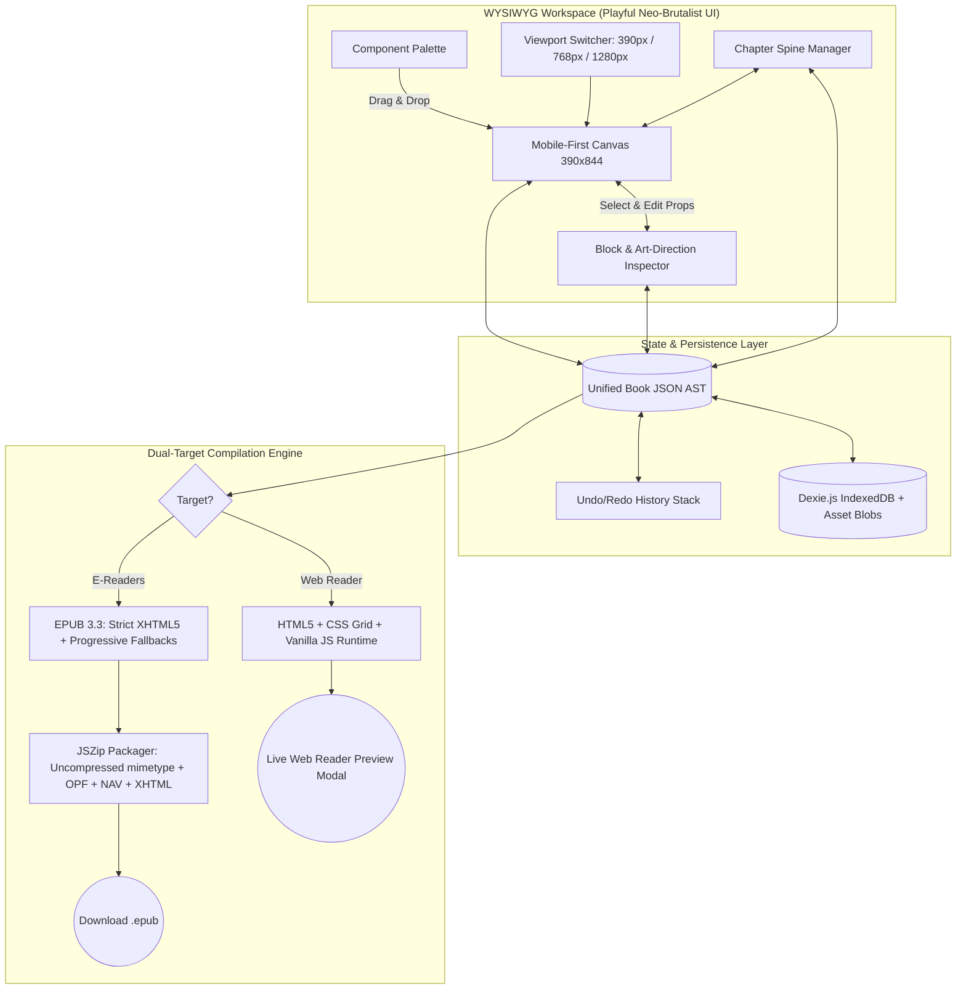

# Wyzard 🪄
### Mobile-First Interactive Ebook & Editorial WYSIWYG Designer

> **Version:** 1.0 (MVP Complete)  
> **Output Targets:** Responsive Editorial Web Publications + Valid EPUB 3.3 Packages  
> **Design Language:** Playful Neo-Brutalism  

---

## 🌟 The Problem Wyzard Solves
Digital publishing has long been trapped between two extremes:
1. **The Fixed-Layout Trap (InDesign FXL):** Rigid pixel aspect ratios force phone readers to constantly pinch-and-zoom.
2. **The Reflowable Straightjacket (Vellum / Reedsy):** Responsive on mobile, but strips away art direction—no magazine hero spreads, asymmetric column splits, art-directed focal points, or interactive widgets.

**Wyzard's Solution:** A mobile-first visual canvas (`390×844` default) with non-destructive desktop spread overrides, powered by a **Dual-Target Compilation Engine** (Responsive HTML5 Web + Strict EPUB 3.3).

---

## 🚀 Quick Start

### 1. Install & Run Dev Server
```bash
npm install
npm run dev
```

### 2. Build for Production
```bash
npm run build
```

---

## 🧱 Architectural Highlights



---

## 🎨 Editorial Block Library

* **Editorial Typography:** Display H1, Section H2, Subhead H3, Lead, Body, and Pull Quotes with relative `rem` presets, font families (`serif`, `sans`, `heading`, `mono`), line-height, tracking, inline rich-text toolbar, and editorial 2/3-line Drop Caps.
* **Art-Directed Image:** Full-bleed breakout margins, aspect ratio locking (`1:1`, `4:5`, `16:9`), interactive visual **Focal Point Crosshair Picker** (`object-position`), and local image upload to IndexedDB.
* **Magazine Hero Spread:** Background image with opacity slider, 4 directional scrim gradient options (`bottom-up`, `top-down`, `vignette`, `solid`), floating editorial title card with `Neo White` and `Dark Glassmorphic` themes.
* **Adaptive Split Container (2-Column):** Automatically renders as a 1-column reading flow on phones, and expands into side-by-side spreads (`50/50`, `60/40`, `70/30`) on tablet/desktop. Features optional editorial vertical hairline divider and mobile reverse stack.
* **Interactive Accordion:** Expandable lore/explainer drawer on the Web that compiles to native `<details><summary>` in EPUB 3.
* **Illustrated Hotspot Pinboard:** Click-to-place numbered pins with interactive popover tooltips on the Web that compile to an annotated image with ordered footnote cards (`<aside epub:type="footnotes">`) in EPUB 3.
* **Visual Gallery & Carousel:** Swipeable horizontal deck on mobile that expands into a 2-column or 3-column grid on desktop, and cleanly unwraps into stacked plates in EPUB 3 without hijacking page-turn gestures.
* **Embedded Audio Narration:** Tactile player with animated audio waveforms, scrub bar, and local audio file storage.
* **Callout Aside Box:** Editorial notes with 5 Neo-Brutalist accent colorways and custom icons.
* **Scene Break Ornament:** Asterisms (`✦ ✦ ✦`), rules, and floral flourishes.
* **Pagination Guardrail:** Universally toggles `break-inside: avoid; page-break-inside: avoid;` across cards and images.

---

## 📚 Starter Templates Included

1. **Digital Culture Magazine Feature:** High-contrast journalism with 60/40 split spreads, pull quotes, and visual gallery decks.
2. **Interactive Educational Field Guide:** Annotated botanical/ecological manual with interactive numbered hotspot pinboard, taxonomy accordions, and observation notes.
3. **Illustrated Children's / Story Spread:** Whimsical fable featuring read-along audio narration, full-bleed art spreads, and fairy-tale drop caps.

---

## 🛠 Tech Stack

* **UI Framework:** React 19 + TypeScript + Vite
* **Visual Editor:** `@craftjs/core`
* **State & Persistence:** Zustand + Immer + Dexie.js (IndexedDB)
* **Design System:** Tailwind CSS (Custom Neo-Brutalist tokens)
* **Packaging & Export:** JSZip + FileSaver.js
* **Icons:** Lucide React (2.5px stroke)
