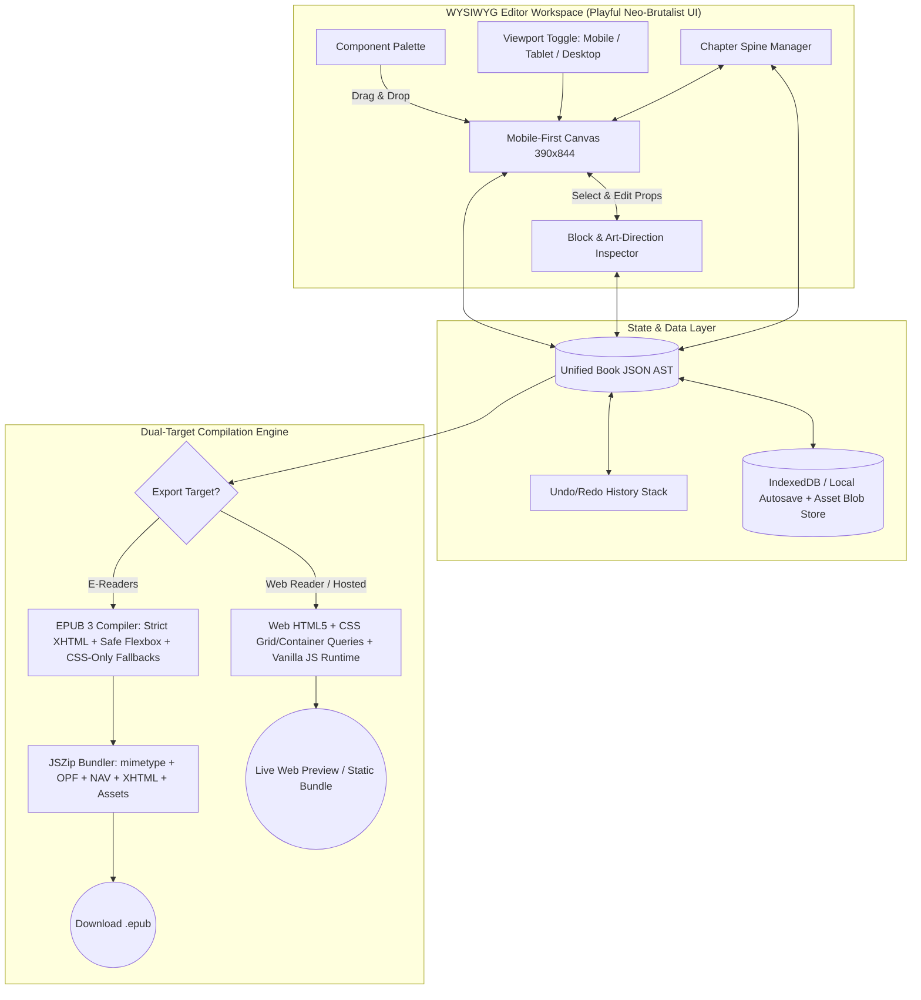

# Product & Technical Specification: Mobile-First Interactive Ebook & Editorial WYSIWYG Designer

**Version:** 1.0 (MVP Blueprint)  
**Target Output:** Responsive Editorial Web Publications + Valid EPUB 3.3 Packages  
**Design Language:** Playful Neo-Brutalism  

---

## 1. Problem Statement & Core Pain Point

Digital publishing sits trapped between two broken workflows, particularly for visual-heavy publications (illustrated books, interactive textbooks, and editorial magazines):

1. **The Fixed-Layout Trap (InDesign FXL / iBooks Author):** Designers get visual freedom, but layouts are locked to rigid pixel aspect ratios. Reading a tablet-designed spread on a smartphone requires constant pinch-and-zooming, forcing publishers to either ruin mobile UX or manually design duplicate layouts per screen size.
2. **The Reflowable Straightjacket (Vellum / Reedsy):** Output adapts cleanly across devices, but strips away art direction. Designers cannot compose multi-column magazine spreads, overlapping typography cards, art-directed image focal points, or interactive visual modules.

**The Core Insight:** Modern publishers design **mobile-first** because smartphones are the primary consumption device, yet they still need layouts to expand gracefully into rich editorial spreads on laptops/tablets—and export to standard `.epub` files without breaking on e-readers.

---

## 2. The Initial Solution (MVP Value Proposition)

A browser-based, **mobile-first visual drag-and-drop designer** powered by a **Dual-Target Compilation Engine**:

* **Mobile-First Visual Canvas (`390×844` default):** Designers drag, drop, and style responsive editorial blocks in a vertical document flow—preserving true reflow while allowing visual art direction (background overlays, asymmetric splits, focal-point cropping, and interactive widgets).
* **Non-Destructive Breakpoint Overrides:** Toggling from **Mobile Portrait** to **Laptop Landscape** lets designers adjust container behavior (e.g., *Vertical Stack* $\rightarrow$ *60/40 Split Spread*) without duplicating content.
* **Single-Source Dual Export:**
  * **Editorial Web Publication:** Exports a responsive HTML5/CSS3/JS bundle with full interactivity (tap-to-reveal hotspots, audio players, swipeable galleries).
  * **EPUB 3 Package:** Compiles the exact same project into strict XHTML5 + safe CSS3 with progressive fallbacks (e.g., turning interactive hotspots into semantic `<aside epub:type="footnote">` popovers and unwrapping horizontal carousels so they don't collide with e-reader page-turn gestures).

---

## 3. System Architecture

Instead of storing fragile raw HTML strings, the editor maintains a **Unified Book AST (Abstract Syntax Tree)** in JSON. Both the live WYSIWYG canvas and the export compilers read from this single source of truth.

### Key Architectural Rules
* **Style Isolation:** The editor's Neo-Brutalist UI styles (`Tailwind CSS`) are strictly isolated from the book canvas (`iframe` or Shadow DOM) so editor CSS never leaks into exported books.
* **Relative Units Only:** All typography, spacing, and container sizing compile to `rem`, `em`, `%`, or `vh/vw`—never static `px` coordinates.
* **Art-Direction Focal Points:** Images store `{ x: number, y: number }` percentages, compiling directly to `object-fit: cover; object-position: X% Y%;` across both Web and EPUB targets.

---

## 4. Recommended Tech Stack

| Layer | Technology | Rationale |
| :--- | :--- | :--- |
| **Frontend Framework** | **React 19 + TypeScript** | Strong ecosystem for visual node trees, strict typing for the Book AST schema. |
| **Visual Editor Engine** | **Craft.js** | Gives full control over drag-and-drop containers, custom block components, and JSON serialization without bloated HTML output. |
| **State & History** | **Zustand + Immer** | Lightweight global state for chapter management, viewport switching, and fast immutable undo/redo snapshots. |
| **Editor UI Styling** | **Tailwind CSS** | Rapid implementation of custom Neo-Brutalist design tokens (hard shadows, thick borders, utility grid). |
| **Local Persistence** | **Dexie.js (IndexedDB)** | Stores multi-chapter projects and high-res image blobs locally in the browser during MVP so users don't lose work. |
| **EPUB & Web Bundling** | **JSZip + FileSaver.js** | Packages valid `.epub` archives (`mimetype` uncompressed first, `META-INF/container.xml`, `content.opf`, `nav.xhtml`, `.xhtml` chapters) entirely client-side. |
| **Icons** | **Lucide React** (with `2.5px` stroke) | Crisp geometric icons that match bold Neo-Brutalist borders. |

---

## 5. Design System: Playful Neo-Brutalism

A tactile, high-contrast "digital print-shop" aesthetic that feels energetic and approachable for editorial designers while keeping the user's book canvas visually distinct from the tool chrome.

### 5.1 Color Tokens
* **Workspace Canvas Backdrop:** `#F4F1EA` (Warm Newsprint Off-White — reduces eye strain around bright book pages)
* **Surface / Panels:** `#FFFFFF` (Pure Crisp White)
* **Primary Ink / Borders:** `#141414` (Off-Black — softer than `#000000`, high contrast)
* **Primary Brand Accent:** `#FF5E3A` (Editorial Vermilion — primary CTAs, active drop-zone indicators)
* **Secondary Accent:** `#FFD23F` (Highlighter Yellow — active selection rings, viewport badges)
* **Tertiary / Interactive Accent:** `#3BCEAC` (Mint Teal — interactive block indicators, EPUB valid status badges)
* **Violet Highlight:** `#9B5DE5` (Electric Lavender — desktop breakpoint override indicators)

### 5.2 Typography
* **UI Headings & Toolbars:** `Space Grotesk` or `Syne` (Bold `700`, tight tracking `-0.02em`)
* **Inspector Controls & Labels:** `Plus Jakarta Sans` or `Inter` (`500`/`600`, crisp legibility at `12px–14px`)
* **Code / CSS / AST Values:** `JetBrains Mono` (Used for focal-point percentages, `rem` values, and export logs)

### 5.3 Borders, Shadows & Tactile Physics
* **Hard Borders:** `2px solid #141414` on all panels, cards, inputs, and buttons (`3px` on primary modals).
* **Hard Offset Shadows (Zero Blur):**
  * Standard Card/Button: `box-shadow: 4px 4px 0px #141414;`
  * Active/Floating Panel: `box-shadow: 6px 6px 0px #141414;`
* **Interactive Press Physics:**
  * Hover: `transform: translate(-1px, -1px); box-shadow: 5px 5px 0px #141414;`
  * Active / Click: `transform: translate(3px, 3px); box-shadow: 1px 1px 0px #141414;`
* **Corner Radius:** Mix sharp structural panels (`4px`) with pill-shaped status tags (`999px`) and chunky buttons (`8px`).

### 5.4 Visual Separation Rule
* The **Editor Chrome** uses heavy `2px` borders, `#FFD23F` selection outlines, and offset shadows.
* The **Book Canvas** inside the viewport frame renders **zero** Neo-Brutalist chrome—only the author's pure book typography, colors, and clean drop-line indicators (`2px dashed #FF5E3A`) when dragging blocks.

---

## 6. Phased MVP Build Roadmap

### Phase 1: Foundation, AST Schema & Neo-Brutalist Shell (Weeks 1–2)
**Goal:** Stand up the editor workspace, state architecture, and local autosave without export logic yet.
* [ ] Define TypeScript interfaces for `BookProject`, `Chapter`, `BlockNode`, and `ResponsiveStyleOverrides` (Mobile default vs. Desktop override).
* [ ] Build the 3-pane Neo-Brutalist workspace layout:
  * **Left Rail:** Chapter Spine list + Draggable Block Palette.
  * **Center Stage:** Interactive Viewport Frame with toggleable presets (`Mobile 390px`, `Tablet 768px`, `Laptop 1280px`).
  * **Right Rail:** Contextual Block Inspector.
* [ ] Integrate **Craft.js** inside an isolated preview frame so blocks can be dragged, reordered, and deleted smoothly.
* [ ] Wire **Zustand + Dexie.js** for instant undo/redo (`Cmd/Ctrl + Z`) and IndexedDB persistence.

### Phase 2: Core Editorial & Visual Layout Blocks (Weeks 3–4)
**Goal:** Build the foundational blocks needed to recreate magazine-style and illustrated layouts.
* [ ] **Editorial Typography Block:** Rich inline text (headings, drop caps, pull quotes, body copy) with `rem` scale presets.
* [ ] **Art-Directed Image Block:** Supports full-bleed, contained, and aspect-ratio locking (`1:1`, `4:5`, `16:9`) plus an interactive **Focal Point Crosshair Picker** (`object-position`).
* [ ] **Magazine Hero Spread Block:** Combines background visual, gradient scrim overlay, and floating editorial title card.
* [ ] **Adaptive Split Container (2-Column):** Defaults to a `1-column vertical stack` on Mobile, with a one-click Desktop override to switch to `50/50`, `60/40`, or `40/60` side-by-side layout.
* [ ] **Pagination Guardrail Toggle:** Add a *"Keep Together on Page Turn"* switch (`break-inside: avoid`) in the inspector for visual cards.

### Phase 3: Interactive Blocks & Dual-Behavior Logic (Weeks 5–6)
**Goal:** Enable multimedia interactivity that works richly on the web and degrades gracefully in EPUBs.
* [ ] **Interactive Reveal / Accordion Card:** Expandable Q&A, lore note, or spoiler box (compiles to animated JS drawer on Web; native `
/
` in EPUB).
* [ ] **Illustrated Hotspot Pinboard:** Designers click on an image to place numbered pins with popup captions (compiles to interactive popover pins on Web; annotated image + numbered footnote cards below in EPUB).
* [ ] **Visual Gallery / Carousel Block:** Swipeable horizontal card deck on Mobile Web, multi-column grid on Desktop Web, and clean stacked editorial cards in EPUB.
* [ ] **Embedded Audio Narration Block:** Custom styled HTML5 `<audio>` player for read-along storytelling or ambient soundtracks.

### Phase 4: Dual-Target Export Compilers (Weeks 7–8)
**Goal:** Turn the JSON Book AST into real, testable deliverables.
* [ ] **Editorial Web Exporter:**
  * Generates clean semantic HTML5 + scoped responsive CSS (using CSS Grid & `@media` / `@container` rules derived from block overrides) + lightweight vanilla JS runtime for hotspots/carousels.
  * Includes a built-in **Live Web Reader Preview** mode with chapter navigation.
* [ ] **EPUB 3.3 Compiler & Packager:**
  * Transforms AST nodes into strict `application/xhtml+xml` compliant markup.
  * Strips unsupported horizontal scroll rules and converts interactive blocks to EPUB-safe fallbacks.
  * Generates `META-INF/container.xml`, `content.opf` (manifest, spine, metadata), `nav.xhtml` (Table of Contents), and packages everything via **JSZip** with an uncompressed `mimetype` entry.
* [ ] **Pre-Flight Validation Check:** Run automated checks before download (missing alt text, oversized images >2MB, unclosed XHTML tags) surfaced in a Neo-Brutalist checklist modal.

### Phase 5: Polish, Starter Templates & Real-World Testing (Week 9)
**Goal:** Validate output across actual reading devices and reduce blank-canvas friction.
* [ ] Create 3 starter templates demonstrating mobile-to-desktop reflow:
  1. *Illustrated Children's / Story Spread*
  2. *Interactive Educational Field Guide*
  3. *Digital Culture Magazine Feature*
* [ ] Test exported `.epub` files across **Apple Books (iOS/macOS)**, **Kobo**, **Thorium Reader (Desktop)**, and **EPUBCheck** validator to fix edge-case CSS rendering quirks.